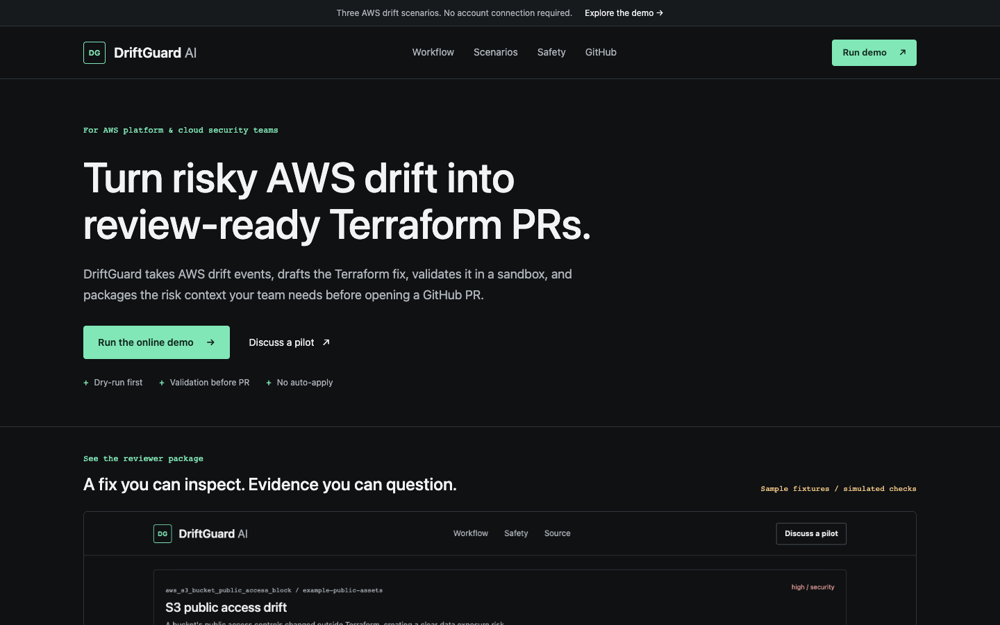
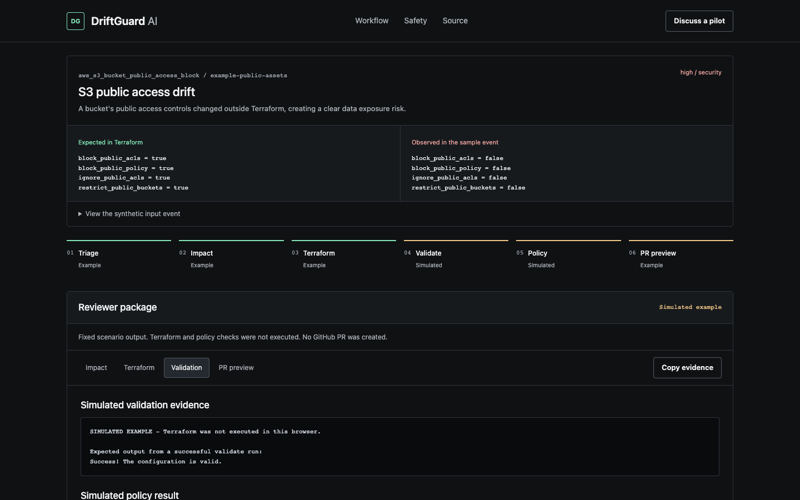

# DriftGuard AI

DriftGuard AI prepares review-ready Terraform fixes from supplied AWS drift events or issue descriptions. A Python LangGraph agent triages the drift, adds security and estimated cost context, generates HCL, runs the Terraform CLI, feeds failures into a bounded correction loop, and prepares a dry-run PR body or a gated GitHub pull request. A static browser interface demonstrates three fixed scenarios. Infrastructure approval and apply remain with the reviewer.

[Published homepage](https://driftguard-ai.pages.dev) | [Published demo](https://driftguard-ai.pages.dev/demo) | [Architecture and C4](docs/architecture.md) | [ADRs](docs/adrs/README.md)

Published links may show an earlier revision until the latest changes are deployed.



## About

Built for AWS platform and cloud security engineers who work in Terraform and GitHub. The focus is the gap between a drift finding and a proposed change with enough evidence for a human reviewer. It accepts supplied events; it is not a hosted AWS drift-discovery service.

## Tech Stack

| Layer | Implementation |
| --- | --- |
| Agent | Python 3.10+, LangGraph, LangChain, Pydantic |
| Models | OpenAI or Anthropic for live runs; fixed mock responses for demos |
| Validation | Terraform CLI subprocesses with timeouts and captured output |
| GitHub | PyGithub for branches, file writes, PRs; GitHub issues for pilot inquiries |
| Frontend | Plain HTML, CSS, JavaScript; no framework or bundler; Cloudflare Pages |
| Optional backend | AWS SAM, API Gateway HTTP API, Lambda container, Boto3, DynamoDB, SSM, CloudWatch |
| Checks | Pytest, Node's built-in test runner, fixture consistency check |

## Engineering Highlights

- Explicit state transitions and bounded correction attempts rather than an unbounded agent loop.
- Structured model responses, redaction before prompts, and failure gates before GitHub writes.
- Real Terraform errors returned to the remediation node, including timeout and missing-binary outcomes.
- One source of truth for synthetic scenarios; exported browser fixtures are checked against Python.
- Honest evidence provenance: browser checks and copied PRs are labeled simulated; backend errors require explicit fallback choice.
- Request cancellation, safe text rendering, wrong-scenario response rejection, and blocked PR display when backend checks fail.

## Architecture

The static frontend can run entirely in the browser. An optional AWS endpoint runs the same graph using mock LLM responses and real Terraform. Live CLI runs can use a real model and scoped GitHub access. See the [C4 container diagram and runtime flow](docs/architecture.md), [five ADRs](docs/adrs/README.md), and [verification record](docs/verification.md).

## Try It In 60 Seconds

1. Open the demo and choose S3 public access, public SSH, or RDS instance-class drift.
2. Compare the expected Terraform baseline with the observed synthetic event.
3. Run the scenario and inspect Impact, Terraform, Validation, and PR preview.
4. Read the mode label: simulated browser evidence is not a Terraform execution.



| Mode | Generation | Checks | GitHub writes |
| --- | --- | --- | --- |
| Browser demo | Fixed fixtures | Simulated; explicitly labeled | None |
| Lambda demo | Fixed mock LLM responses through LangGraph | Real Terraform and built-in policy checks | None for public requests; optional admin sandbox PR |
| Local CLI | Real model or `--mock-llm` | Real Terraform and built-in policy checks | Disabled with `--dry-run` |

## Who This Is For

- Platform teams using AWS, Terraform, and GitHub.
- Cloud security teams that need faster remediation without skipping review.
- DevOps teams that want drift fixes to land as normal infrastructure pull requests.

## What It Does Today

1. Accepts a plain-English drift description or JSON AWS event.
2. Uses an LLM-backed LangGraph workflow to triage, analyze impact, remediate, validate, and self-correct.
3. Runs `terraform init` and `terraform validate` in a temporary directory.
4. Runs built-in policy checks for obvious unsafe Terraform patterns.
5. Opens a GitHub PR, or renders a PR preview in dry-run mode.

## Requirements

- Python 3.10+
- Terraform CLI on `PATH`
- Network access for `terraform init` when generated HCL needs provider plugins
- OpenAI or Anthropic API key for real runs
- GitHub token for live PR creation

## CLI Quickstart

For a local execution with deterministic model responses and real Terraform, without GitHub writes:

```bash
python3 -m venv .venv
source .venv/bin/activate
pip install -r requirements.txt

python driftguard.py \
  --event examples/s3_public_access_drift.json \
  --dry-run \
  --mock-llm
```

Expected result: a run summary with impact analysis, real Terraform validation output, policy-check output, and a GitHub PR body preview. Provider installation can require network access.

The CLI runs preflight checks before invoking the agent. Missing Terraform, LLM keys, model configuration, or GitHub settings are reported before any live API calls are made.

## Real LLM Dry Run

```bash
cp .env.example .env
# Edit .env with your model provider and API key.

python3 driftguard.py \
  --event examples/s3_public_access_drift.json \
  --dry-run
```

## Live GitHub PR Run

```bash
python3 driftguard.py \
  --event examples/s3_public_access_drift.json
```

Live PR creation requires:

- `GITHUB_TOKEN`
- `GITHUB_REPOSITORY`
- `GITHUB_BASE_BRANCH`
- `GITHUB_TERRAFORM_FILE_PATH`

For production, use a least-privilege GitHub App installation token instead of a broad personal access token.

## Environment Variables

See [.env.example](.env.example).

Important variables:

- `DRIFTGUARD_LLM_PROVIDER`: `openai` or `anthropic`
- `DRIFTGUARD_LLM_MODEL`: approved model name
- `OPENAI_API_KEY` or `ANTHROPIC_API_KEY`
- `GITHUB_TOKEN`: token with branch, contents, and pull request permissions
- `GITHUB_REPOSITORY`: `owner/repo`
- `GITHUB_BASE_BRANCH`: default branch, usually `main`
- `GITHUB_TERRAFORM_FILE_PATH`: file path to create or update in the remediation PR

## Safety Model

DriftGuard does not auto-apply infrastructure changes. It produces reviewable PRs.

Current safety controls:

- Common secret patterns and account IDs are redacted before LLM prompts; this is not comprehensive DLP.
- Terraform runs in a temporary directory. This is not a hardened sandbox for arbitrary HCL.
- Obvious unsafe Terraform patterns are blocked before PR creation.
- Validation and policy failures are fed back into the remediation loop.
- Dry-run mode renders a PR preview without writing to GitHub.

See [SECURITY.md](SECURITY.md) for security boundaries and production guidance.

Terraform validate does not establish deployment safety. Review a plan, resource/state alignment, operational impact, and organization-specific policies. The built-in checks are intentionally narrow. The live PR writer can replace the configured file; it does not create a repository-aware patch. RDS examples are standalone fixtures, not production rollback instructions.

Browser simulation uses synthetic data locally. With the backend configured, only the scenario name and `create_pr: false` are submitted. Compact run records default to 30-day TTL; CloudWatch logs default to 3-day retention. Live LLM runs send redacted prompt content to the configured provider. Pilot inquiries are public GitHub issues; do not include infrastructure secrets or private identifiers.

## CLI Usage

```bash
python3 driftguard.py --help
```

Common options:

- `--event path.json`: load a drift event fixture or production event payload.
- `--issue "description"`: run from a plain-English issue description.
- `--dry-run`: generate a PR preview only.
- `--mock-llm`: use deterministic demo responses.
- `--json`: print final graph state as JSON.

## Testing

```bash
pip install -r requirements-dev.txt
pytest
node --test tests/frontend.test.cjs
python3 scripts/export_demo_scenarios.py --check
git diff --check
```

Terraform-dependent tests are skipped when the Terraform CLI is missing. Node 18+ is needed for the frontend tests; the deployed site needs no Node runtime. After changing `demo_scenarios.py`, regenerate the browser fixtures with `python3 scripts/export_demo_scenarios.py`.

## Demo Talk Track

Use this flow when showing DriftGuard to users or hiring managers:

1. "DriftGuard prepares Terraform proposals with evidence. Your team reviews the plan and controls apply."
2. Open the browser demo. "This is a synthetic S3 event: public access controls moved away from the private baseline."
3. Run the scenario and open Terraform. "Here is the proposed HCL; existing resource addresses and state still need reconciliation."
4. Open Validation. "This browser example is simulated. A configured Lambda endpoint runs real Terraform; real model inference is a separate live CLI path."
5. Open PR preview. "The reviewer gets impact, rationale, and check evidence. Failed checks block PR preparation."
6. Show the security group or RDS example. "A pilot evaluates one agreed baseline in a sandbox before any supervised GitHub writes."
7. For technical review, show the [architecture](docs/architecture.md), [ADRs](docs/adrs/README.md), and failure-contract tests.

## Sales Landing Page

The static landing page lives at [site/index.html](site/index.html). It is aimed at platform and cloud security teams evaluating a focused drift-remediation pilot.

The browser demo lives at [site/demo.html](site/demo.html). Scenario links support `?scenario=s3`, `?scenario=security-group`, and `?scenario=rds`. Simulation is the default. Configure `window.DRIFTGUARD_DEMO_API_URL` for real backend validation; arbitrary local-storage endpoint overrides are not supported.

For local review, open `site/index.html` in a browser, or serve it with `python3 -m http.server 4176 --bind 127.0.0.1 --directory site` and visit `http://127.0.0.1:4176`. The "Open a pilot inquiry" CTA opens a prefilled issue draft in the existing GitHub repository. Submission, confirmation, and replies happen on GitHub; there is no signup or billing claim.

The optional AWS backend lives in [infra/demo-backend](infra/demo-backend). It avoids always-on compute using API Gateway, Lambda, DynamoDB on-demand, short log retention, reserved concurrency, and optional $5/month budget alerts. Alerts do not impose a hard spending cap; image storage, traffic, and logs still cost money. Public runs use fixed mock LLM responses and real Terraform.

## Frontend Deployment

The Cloudflare Pages frontend serves the static files from `site/`.

```bash
wrangler pages deploy site --project-name driftguard-ai --branch main
```

After deploying the AWS backend, set `window.DRIFTGUARD_DEMO_API_URL` in [site/demo-config.js](site/demo-config.js) to the CloudFormation `DemoApiUrl` output and redeploy the frontend. A blank URL uses browser simulation. Failed API requests show an error with retry and an explicit simulated-example option; they do not silently pass validation.

## Project Structure

```text
driftguard.py                 Agent graph, Terraform commands, policy and GitHub gates
demo_scenarios.py             Authoritative fixed demo fixtures
lambda_function.py           Fixed-scenario API adapter and optional run records
site/                        Homepage, demo, shared contract and generated fixtures
scripts/export_demo_scenarios.py
infra/demo-backend/           SAM template, Lambda Dockerfile, deployment guide
tests/                       Agent/API tests and Node frontend contract tests
docs/architecture.md          C4 diagram, runtime flow, data and deployment boundaries
docs/adrs/                   Architecture decision records
docs/screenshots/            Actual rendered product captures
```

## Production Boundary

The current scope is a supervised technical evaluation. Broad paid adoption needs tenant authentication, private onboarding, production ingestion, repository-aware patches, a stronger policy scanner, customer-accessible audit history, billing, and abuse controls. DynamoDB metadata is not a tenant history UI. No customer counts, compliance certifications, or measured time/cost savings are claimed.
