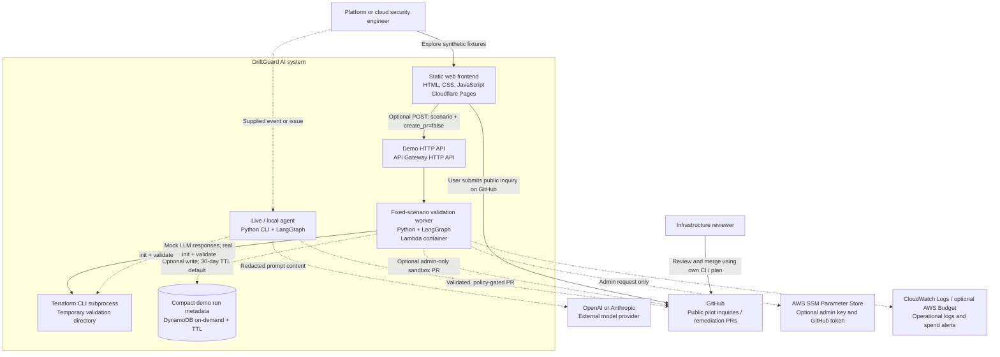
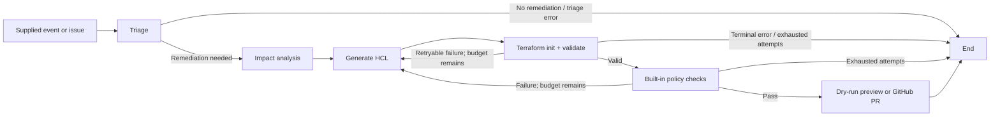

# Architecture

DriftGuard prepares Terraform remediation proposals from supplied AWS drift descriptions or JSON events. It combines a Python LangGraph agent with a static browser demo and an optional AWS validation API. It does not continuously discover drift, apply infrastructure, or provide a multi-tenant SaaS service.

## C4 Container View

Solid arrows are the public demo path. Dashed arrows are optional live-agent, persistence, or administrator paths. The LangGraph nodes run inside one Python process, not independently deployed agent services.

The Terraform node represents the child process embedded in the CLI host or Lambda image, not a network service. The public browser cannot access SSM or write PRs.

## Runtime Flow

- `driftguard.py` owns structured Pydantic outputs, node errors, bounded correction attempts, subprocess timeouts, PR formatting, and GitHub writes.
- `demo_scenarios.py` is the authoritative source for the three synthetic scenarios. `scripts/export_demo_scenarios.py` generates `site/scenarios.js`; `--check` catches drift between Python and browser fixtures.
- `site/demo-core.js` distinguishes simulation from actual API evidence, rejects incomplete or wrong-scenario responses, aborts slow requests, and blocks inconsistent PR-ready output after failed checks.
- `site/demo.js` handles comparison, scenario deep links, view selection, loading, errors, reset/cancellation, copying evidence, and pilot inquiries. Rendering uses text nodes for backend content.
- Browser mode never executes Terraform or policy checks. It labels the screen, validation evidence, and copied PR body as simulated. A failed backend request requires an explicit user choice before displaying simulation.
- Lambda invokes the same graph with deterministic mock LLM responses. Terraform execution is real, even though generation is fixed. Public requests always use `create_pr: false`; the handler also protects optional sandbox PR creation with an admin key.

## Deployment Shape

| Layer | Deployment | Important configuration |
| --- | --- | --- |
| Frontend | Cloudflare Pages, static `site/` directory | `site/demo-config.js`; no frontend secrets |
| API / worker | Optional SAM stack, API Gateway + Lambda image | `infra/demo-backend/template.yaml`, bundled Terraform |
| Run metadata | Optional DynamoDB on-demand table | 30-day TTL by default; no browser retrieval endpoint |
| Admin credentials | Optional SSM parameters | Read server-side only for sandbox PR requests |
| Observability | CloudWatch logs; optional AWS Budget alerts | 3-day log retention, concurrency default 2, Lambda timeout default 60s |
| Live agent | User-controlled Python process | Model API key, Terraform, scoped GitHub configuration |

The frontend works without the backend. No VPC, NAT gateway, database server, or provisioned compute is required. Budget alerts are notifications, **not a hard $5 spending cap**. Image storage, logs, requests, and traffic can incur charges.

## Data And Trust Boundaries

1. Browser simulation displays synthetic fixture data locally. Pilot CTAs open GitHub's issue composer; they do not silently submit a form or store contact details.
2. Configured backend runs submit only a fixed scenario name and the disabled PR flag. DynamoDB stores run IDs, timestamps, scenario, outcomes, and trimmed errors rather than full prompt/HCL content. TTL deletion is asynchronous.
3. Live agent prompts go to the configured LLM provider after pattern-based redaction. Redaction does not guarantee removal of all sensitive data.
4. Terraform runs in a temporary directory with timeouts. This is filesystem separation, **not a hardened sandbox for arbitrary untrusted HCL**. Provider installation may use the network; the process inherits environment variables. Generated backend declarations also need careful review.
5. Terraform validate checks configuration consistency, not the actual AWS baseline or safety of a deployment. The built-in policy scanner is narrow and pattern-based. A reviewer must inspect resource/state alignment, a plan, organization policies, and operational consequences.
6. The live PR writer creates or replaces the configured file. It is not a repository-aware patch engine. Do not point it at a production file until you have evaluated the behavior in a sandbox.

## Decisions And Verification

See [ADRs](adrs/README.md) for the reasoning behind this shape and [verification notes](verification.md) for the latest checks. Tests cover the agent's failure gates, API authorization, frontend provenance and cancellation, and fixture consistency. Screenshots document an actual rendered browser simulation; they are not evidence of a deployed Lambda run.
